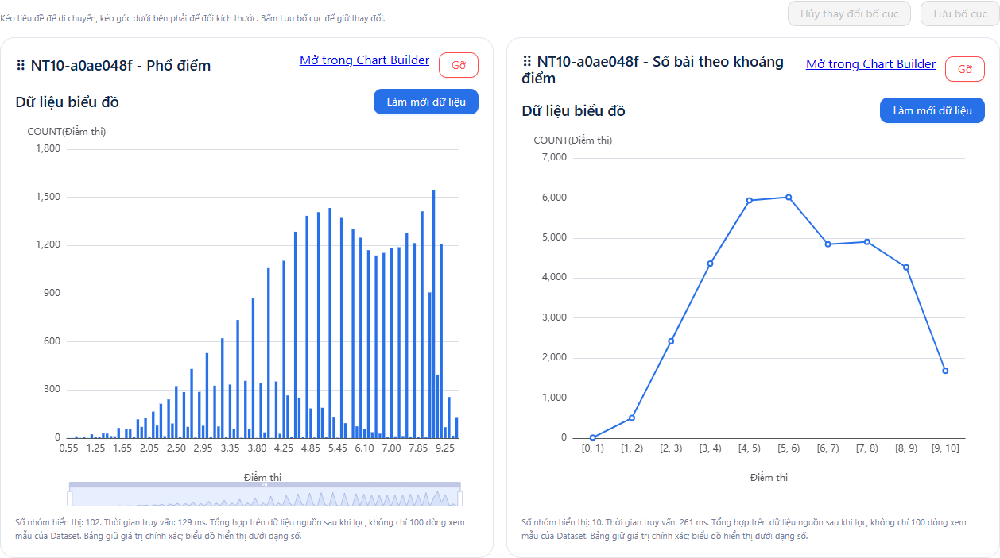

# Biên bản nghiệm thu bước 10 — Dashboard

Ngày nghiệm thu: 25/10/2026. Kết quả: **ĐẠT phạm vi PoC đã chốt**.

Nghiệm thu chạy Chrome → React/Vite → Spring Boot → MySQL thật, không giả lập phản hồi API. SQL đối chiếu được chạy độc lập bằng tài khoản reader. Dashboard demo được giữ lại để review; cấu hình có trước và dữ liệu nguồn được đối chiếu trước/sau bằng dấu kiểm.

## Demo đã lưu

| Thành phần | ID | Tên/cấu hình |
| --- | --- | --- |
| Dataset | 8 | NT10-a0ae048f - Điểm thi; tham chiếu exam_scores |
| Biểu đồ cột | 5 | NT10-a0ae048f - Phổ điểm; dimension score, COUNT(score), tăng dần |
| Biểu đồ đường | 6 | NT10-a0ae048f - Số bài theo khoảng điểm; COUNT(score), khoảng rộng 1 trong đoạn 0–10 |
| Dashboard | 5 | NT10-a0ae048f - Dashboard nghiệm thu |
| Bộ lọc chung | — | Dataset 8, subject_name, giá trị Toán |

Hai biểu đồ dùng cùng dataset, không cố định môn riêng. Khoảng cuối [9,10] gồm điểm 10, các khoảng trước gồm cận trái và không gồm cận phải. Bố cục cuối gồm hai thẻ cạnh nhau, mỗi thẻ rộng 6/12 cột và cao 14 hàng.

Khởi động backend/frontend, mở Dashboard và chọn **NT10-a0ae048f - Dashboard nghiệm thu**, hoặc mở đường dẫn `/dashboards?dashboardId=5` trên frontend đang chạy.

## Kết quả kiểm tra

| Tiêu chí | Kết quả |
| --- | --- |
| Kết nối đã lưu đọc được bảng/cột thật | Đạt; kiểm tra lại kết nối thành công, exam_scores có 8 cột |
| Chọn bảng, xem trước, đặt tên dataset/nhãn cột, lưu và reload | Đạt; preview 100 dòng, nhãn Điểm thi/Môn học giữ nguyên |
| Tạo cột và đường từ cùng dataset, preview, lưu và mở lại | Đạt; số liệu từng nhóm khớp SQL |
| Tạo dashboard và thêm hai biểu đồ | Đạt; reload vẫn có đủ hai biểu đồ, ECharts vẽ được cả hai |
| Toán, Ngữ văn và Tất cả cập nhật cả hai biểu đồ | Đạt; mọi nhóm phổ điểm và khoảng điểm khớp SQL độc lập |
| Lưu/mở lại bộ lọc | Đạt; reload giữ lựa chọn Toán |
| Kéo bằng tiêu đề và resize bằng chuột | Đạt; tọa độ/kích thước thay đổi, lưu và reload giữ nguyên |
| Thu nhỏ màn hình | Đạt; hiển thị một cột, bố cục desktop không bị ghi đè |
| Gỡ và thêm lại | Đạt; biểu đồ gốc còn nguyên, bố cục biểu đồ khác giữ nguyên |
| Lỗi JavaScript trong luồng nghiệm thu | Không có |
| Dữ liệu nguồn và cấu hình có trước | Giữ nguyên; xác minh SHA-256 các dòng cấu hình cũ, đối chiếu thống kê nguồn trước/sau |

## Số liệu đối chiếu

| Bộ lọc | Nhóm điểm | Khoảng điểm có dữ liệu | Tổng COUNT(score) |
| --- | ---: | ---: | ---: |
| Toán | 102 | 10 | 34.952 |
| Ngữ văn | 39 | 10 | 35.015 |
| Tất cả | 141 | 10 | 140.567 |

Đây là số dòng điểm/bài thi, không phải tổng số thí sinh duy nhất. Bộ dữ liệu nguồn có 140.567 dòng điểm của 35.526 mã thí sinh. Tổng COUNT(score) từ hai cách nhóm khớp nhau trong từng kịch bản.

SQL đối chiếu cơ bản:

```sql
SELECT score, COUNT(score)
FROM exam_scores
WHERE score IS NOT NULL AND subject_name = ?
GROUP BY score ORDER BY score;

SELECT CASE WHEN score = 10 THEN 9 ELSE FLOOR(score) END AS khoang,
       COUNT(score)
FROM exam_scores
WHERE score >= 0 AND score <= 10 AND subject_name = ?
GROUP BY 1 ORDER BY 1;
```

Với Tất cả, bỏ điều kiện subject_name. Quy tắc AND, giữ bộ lọc riêng và không truy vấn lại biểu đồ dataset khác đã được kiểm tra ở bộ test chức năng; hai biểu đồ demo nghiệm thu không đặt môn riêng để dashboard quyết định môn học.

## Bằng chứng và cách chạy lại



- Java opt-in: `Step10AcceptanceMySqlIT`, ba giai đoạn prepare/verify và cleanup cho lần chạy dở dang.
- Browser opt-in: `frontend/e2e/step10-live-acceptance.spec.ts`. Tạo cấu hình bằng UI thật, đối chiếu mọi nhóm với baseline SQL, giữ demo thành công.
- Kết quả máy đọc nằm trong backend/target/step10-acceptance-baseline.json, step10-acceptance-browser.json và step10-acceptance-verified.json (target không đưa vào Git).
- Nghiệm thu này không sửa code chức năng. Ảnh được chụp sau khi canvas kết thúc hiệu ứng để phản ánh kết quả đầy đủ.

Để chạy lại, từ backend chạy `mvnw.cmd -o -Dtest=Step10AcceptanceMySqlIT -Ddatademo.acceptance.phase=prepare test`. Từ frontend đặt biến môi trường DATADEMO_LIVE_ACCEPTANCE=1, chạy `npm run test:e2e -- e2e/step10-live-acceptance.spec.ts`; sau đó từ backend chạy `mvnw.cmd -o -Dtest=Step10AcceptanceMySqlIT -Ddatademo.acceptance.phase=verify test`. Mỗi lần prepare tạo prefix mới và lần chạy thành công giữ thêm một demo; chỉ chạy khi chủ động nghiệm thu.

Bước 10 được chốt cho phạm vi dashboard PoC. Chia sẻ công khai, nhúng và phân quyền vẫn ngoài phạm vi đã thống nhất.
